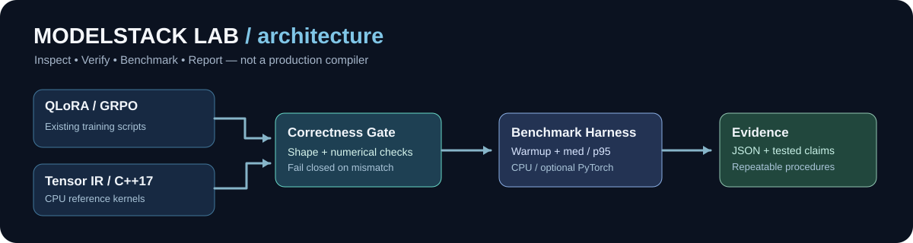
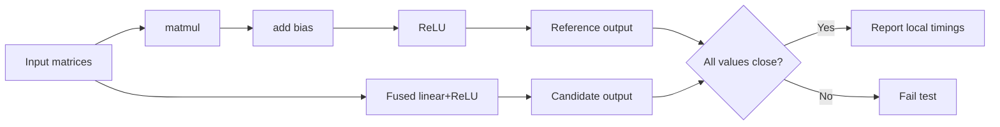

# ModelStack Lab

### Reproducible model post-training and execution-efficiency experiments



**What it is.** ModelStack Lab combines the repository's original **QLoRA supervised fine-tuning and GRPO mathematical-reasoning post-training** scripts with a small, inspectable **tensor-execution and benchmarking laboratory**. It makes the supporting systems questions testable: *does a graph rewrite preserve results; how expensive is execution on this hardware; what information should a researcher save with each measurement?*

**What it is not.** This is an educational, research-oriented toolkit, **not** a general tensor compiler, distributed trainer, validated CUDA kernel library, or guaranteed production-ready LLM training pipeline. Claims below refer to code or checks that actually exist. See [verification and known limits](docs/ARCHITECTURE.md#known-limits-and-verification-truth-table).

## 60-second first run (no model downloads)

Requires Python **3.11+**. The default graph and doctor commands use the Python standard library only.

```bash
python -m modelstack_lab doctor
python -m modelstack_lab graph --size 12 --iterations 15 --seed 42
python -m unittest discover -s tests -v
```

The graph command prints JSON with the **actual** median/p95 CPU timings, number of graph operation nodes, logical intermediate materializations, and numerical discrepancy. There are **no prewritten benchmark wins**. Both outputs are computed on your machine. Larger inputs are bounded to prevent accidental overload.

### CPU reference compiler experiment



The pass fuses **only** `matmul → add_bias → relu` when the two intermediates each have exactly one consumer. Non-finite values, ragged matrices, missing inputs, shape errors and invalid graph ordering cause explicit errors rather than an invented result.

### Native C++17 CPU baseline

You need CMake 3.16+ and a C++17 compiler, but no GPU or additional libraries:

```bash
cmake -S . -B build
cmake --build build --config Release
ctest --test-dir build -C Release --output-on-failure
# macOS/Linux: ./build/tensorbench --size 48 --iterations 20
# Windows MSVC: .\build\Release\tensorbench.exe --size 48 --iterations 20
```

The C++ program compares unfused and fused post-processing around a contiguous matrix-multiplication implementation and verifies numerical agreement before reporting machine-specific measured times. It is **not** an optimized CUDA implementation.

### Optional no-download PyTorch profiling

Install PyTorch using the [official environment selector](https://pytorch.org/get-started/locally/) appropriate for your OS and accelerator. A synthetic, seeded MLP benchmark does not download weights or datasets:

```bash
python -m modelstack_lab torch-bench --device cpu --size 128 --iterations 15
# Opt in to compiler use; warmup/compilation can be expensive:
python -m modelstack_lab torch-bench --device cpu --size 128 --iterations 15 --compile
# CUDA only on a properly provisioned machine:
python -m modelstack_lab torch-bench --device cuda --size 128 --iterations 15
```

CUDA is **never** activated without `--device cuda`. Every compiled output is checked against eager execution. Warmup is excluded from the steady-state timing. See [benchmark protocol](docs/ARCHITECTURE.md#benchmark-protocol).

## Original QLoRA and GRPO post-training

Install the original optional training dependencies into a dedicated virtual environment:

```bash
python -m venv .venv
# activate .venv for your operating system
python -m pip install -r requirements.txt
python train_qlora.py --model-id Qwen/Qwen2.5-Math-7B-Instruct \
  --dataset-id openai/gsm8k --dataset-config main --max-samples 64 --epochs 0.05
python train_grpo.py --model-id Qwen/Qwen2.5-Math-7B-Instruct \
  --dataset-id openai/gsm8k --dataset-config main --max-samples 64
```

Windows users can run equivalent commands on one line. Training requires access to its model/dataset and enough compatible GPU memory; **7B full execution on an 8 GB laptop GPU is not verified or promised**. The repo provides inspectable scripts for LoRA adapters, QLoRA 4-bit NF4 configuration, tokenizer formatting, GRPO correctness/format rewards, and reward tests. It does **not** claim a confirmed final model-quality improvement. For measured reproducibility record model revision, tokenizer, dependencies, split, seed, training config, hardware, loss curves, checkpoints and held-out evaluation before publishing metrics.

## Repository at a glance

| Component | Why it belongs | Verification |
|---|---|---|
| `train_qlora.py` | Parameter-efficient supervised training experiments | Inspectable configuration; GPU training not CI-tested |
| `train_grpo.py`, `rewards.py` | Mathematical reasoning rewards and RL training entry point | Deterministic reward tests |
| `modelstack_lab/ir.py` | Bounded tensor graph + single-use fusion pass | Property-style randomized and edge-case tests |
| `modelstack_lab/benchmark.py` | Warmup, p95/median, correctness, optional PyTorch | Stdlib tests; optional torch execution |
| `native/tensorbench.cpp` | C++17 memory/loops and CPU baseline | CMake/CTest correctness checks |
| `scripts/release_check.py` | One command to verify portable pieces | Compiler, unit, CLI, CTest |
| `.github/workflows/verification.yml` | Repeatability on Windows and Ubuntu | CI checks when enabled on GitHub |
| `docs/ARCHITECTURE.md` | Limits, risk analysis, experiments and roadmap | Explicit honest evidence policy |

## Release verification

```bash
python scripts/release_check.py
```

Passing on a machine means **the specific local release checks passed on that machine**. It does not prove that optional full-model training, GPU compilation, Windows-specific external dependencies, or multi-node distributed performance works. Failures and limitations belong in reports; improvements must be supported by real measurements.

## Research roadmap

1. Capture real torch.profiler traces and torch.compile break reports, measure true memory before claiming memory savings.
2. Extend IR with layouts/strides, shape inference, automatic-differentiation reference checks and more rigorous graph passes.
3. Implement optional tested CUDA kernels with CPU parity, sanitizer/profiler checks and feature-gated CI runners.
4. Add reproducible end-to-end adapter training artifacts and held-out evaluation on accessible GPU hardware.
5. Assess distributed training only on real distributed hardware, with verified checkpoints and failure-recovery tests.

**Design and methodology:** [Engineering notes](docs/ARCHITECTURE.md) · [Architecture SVG](docs/architecture.svg). The graph drawing is an **architectural illustration**, not fabricated profiler output.
