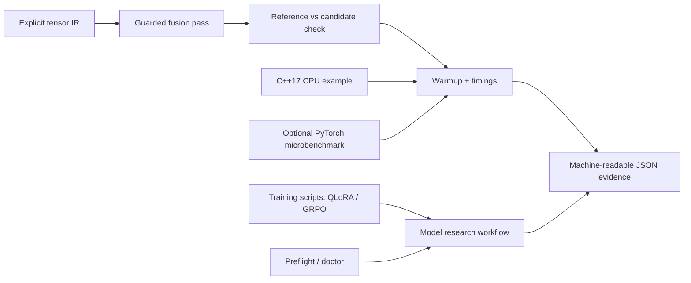

# ModelStack Lab engineering notes

## Goal and scope

The existing repository provides training entry points for QLoRA supervised fine-tuning and GRPO mathematical-reasoning post-training. ModelStack Lab adds a **bounded, reproducible systems-experiment layer** alongside them. Researchers can inspect environment compatibility; test a small, explicitly defined tensor graph; compare an unfused and guarded-fused graph; benchmark equivalent CPU C++17 execution; and benchmark a no-download synthetic PyTorch MLP on CPU or an available GPU. Together these parts support a single use case: **measure and improve the implementation choices around model training and inference without obscuring correctness or benchmark provenance**.

This package is deliberately **not** a replacement for torch.compile, PyTorch Inductor, CUDA, distributed training frameworks, or a production compiler. Its minimal IR contains `matmul`, `add_bias`, `relu`, and `linear_relu` only, and it has no automatic differentiation.

## System boundaries

The original training entry points still require separately installed `torch`, `transformers`, `datasets`, `accelerate`, `peft`, `trl` and `bitsandbytes` and model/dataset downloads. The stdlib-only CLI and its tests do **not** require them. The optional `torch-bench` command only requires `torch`, does not download models, and rejects CUDA requests if a CUDA runtime is unavailable.

## IR contract

- Nodes are immutable and listed in topological order; operation names are unique identifiers.
- External feeds must not shadow output node names.
- Matrices must be nonempty, rectangular, finite, within 512 rows and columns, and within 262,144 elements per tensor.
- The fusion pass recognizes `matmul(x,w)` → `add_bias(..., b)` → `relu(...)` only if both intermediates have exactly one consumer. It preserves the output node name and does not fuse if an intermediate is shared.
- Each benchmark first executes both variants and compares every element at absolute tolerance 1e-9. Failing correctness is an error, not a warning.
- The `intermediate_output_elements` field counts all materialized node outputs (a logical proxy), **not** observed maximum RSS, allocator occupancy, or GPU VRAM.
- The interpreter stores all node outputs until the call completes, even if no consumer needs them. Fusion changes logical allocations, but **does not** prove a peak resident memory reduction.
- Floating-point results from C++17 may differ with compiler optimization; the C++ reference checker compares a specific eager vs fused implementation with maximum absolute error 1e-5.

## Benchmark protocol

1. Fix an explicit pseudorandom seed and shape; never use a downloaded model as an implicit dependency of a fast smoke test.
2. Use warmup iterations that are excluded from timing.
3. Measure single operation calls using a high-resolution clock and report median and nearest-rank p95; when CUDA is used, synchronize before and after each timed call.
4. For `torch.compile`, exclude graph compilation and initialization from steady-state timing; **compile overhead must be measured separately** before deciding if the optimization is worthwhile.
5. Verify candidate numerical output against eager reference before reporting compiled results.
6. Record backend, device, seed, size, iterations and software version. CPU timing is noisy and hardware-specific; there are no universal speedup claims.
7. Neither synthetic MLP inference timings nor toy graph microbenchmarks demonstrate full-model training throughput or multi-node scaling.

## Security and operational controls

- No shell interpolation, `eval`, `exec`, downloaded executables, network requests, model loading, or arbitrary plugin loading in the new default CLI.
- Validated bounded shapes and iteration counts prevent accidental huge workloads. GPU use is explicitly opt-in via `--device cuda`, and no GPU benchmark runs in normal CI.
- Environment doctor reports device/tool availability; it does not print tokens or private configuration.
- No magic success paths: mismatches throw/return exit code 2. CI tests malformed, adversarial, shared-dependency and deterministic inputs.
- The old training entry points intentionally remain independent; they are research scripts and have **not** been certified end-to-end in this release. Actual training requires sufficient GPU RAM, dependencies, valid model and dataset access, and separate experiment logs.

## Known limits and verification truth table

| Feature | Evidence | Status |
|---|---|---|
| CPU reference tensor IR and fusion | unittest suite | Tested locally |
| C++17 baseline + guarded fused output | g++/CMake/CTest | Tested locally |
| CLI doctor/CPU graph | Python stdlib CLI smoke | Tested locally |
| PyTorch synthetic MLP CPU | optional CLI run | Run and record per machine |
| torch.compile backend | optional, potentially expensive | Opt-in; no automatic CI certification |
| CUDA kernels / CUDA compile | no custom CUDA code in this release | Not implemented |
| QLoRA/GRPO full training | original code and reward unit tests only | Not end-to-end validated |
| Multi-node distributed transformer training | no distributed executor | Not implemented |

## Engineering roadmap

- **Next:** User-operated profiler captures using `torch.profiler`, `torch.compile` graph-break reports and true peak-memory measurements; revise benchmarks from findings, not conjecture.
- **Then:** Implement independent C++ tensor view/layout, shape/stride ownership tests, alignment/vectorization investigation and an opt-in CUDA kernel with explicit compute capability and reproducible validation.
- **Later:** Verified single-GPU training runs, tokenizer/dataset provenance, adapter checkpoints, evaluation harness on held-out samples, model card, and reproducible report artifacts.
- **Beyond single GPU:** Distributed training and transport correctness tests on actual multi-node hardware; this cannot be truthfully simulated by single-machine unit tests alone.

## References

- https://docs.pytorch.org/docs/stable/generated/torch.compile — optimization API and limitations.
- https://docs.pytorch.org/docs/stable/user_guide/torch_compiler/torch.compiler_profiling_torch_compile.html — profiler and trace methodology.
- https://docs.nvidia.com/cuda/cuda-c-best-practices-guide/index.html — memory access and profiling practices.
